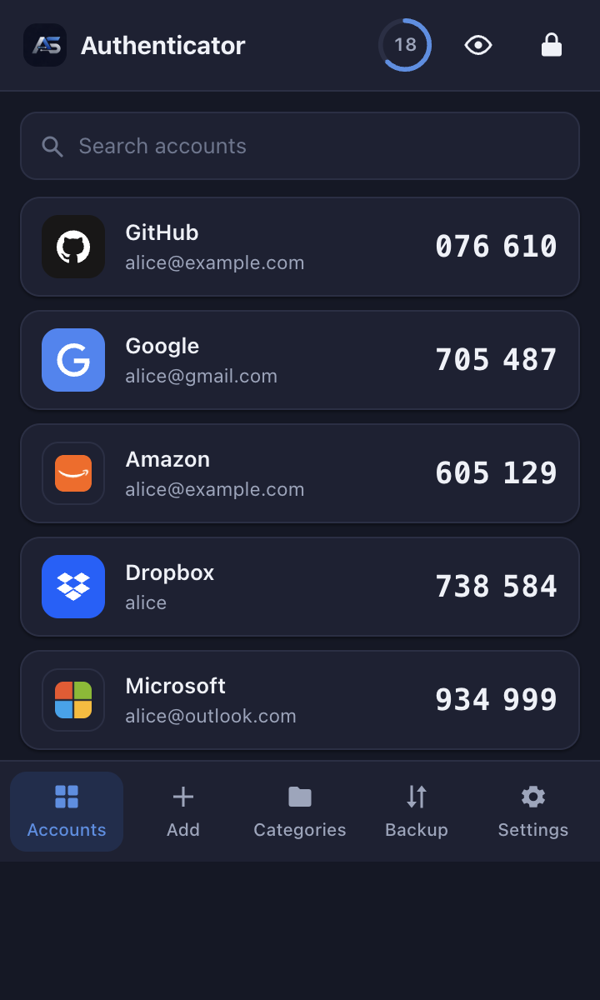
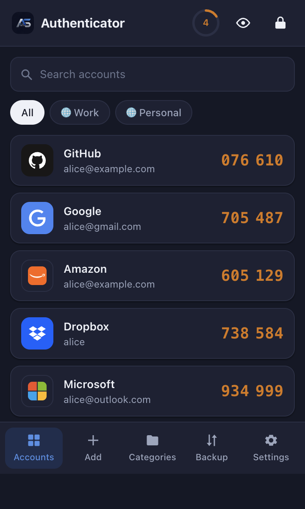
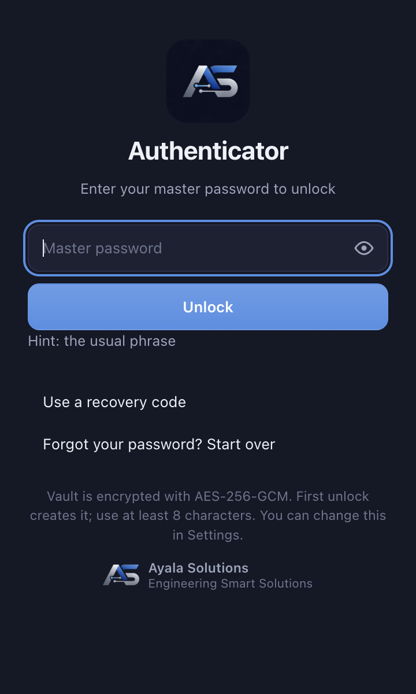

# AS Authenticator Browser Extensions

Two-factor codes, encrypted, in your browser. A browser extension by Ayala Solutions for Chrome, Edge, Brave, Firefox and Safari, in English, Spanish, French, German and Brazilian Portuguese.

## Get it

| Browser | Install |
| --- | --- |
| Chrome, Brave | [Chrome Web Store](https://chromewebstore.google.com/detail/as-authenticator/dbpnmcknkbkphpadmgifjmnmgpknfjec) |
| Edge | [Edge Add-ons](https://microsoftedge.microsoft.com/addons/detail/lngdcjajclmcaeagnielbpcfedigndnd) |
| Firefox | [Firefox Add-ons](https://addons.mozilla.org/en-US/firefox/addon/as-authenticator/) |
| Safari | [Mac App Store](https://apps.apple.com/us/app/as-authenticator/id6818379710?mt=12) (the app turns the extension on in Safari) |

The **[user guide](docs/USER-GUIDE.md)** walks through every screen with screenshots: first run, adding accounts,
filling codes, categories, backup, settings, the lock screen and the differences between browsers.

This repository holds the public documents for AS Authenticator: the user guide, the privacy policy, the security
policy, the vault format, the security audit report and the changelog. The extension's source is maintained privately;
every release ships with a SHA-256 for each packaged file, listed in the changelog's release notes, so an installed
copy can be checked.

## What it does

- Generates TOTP, HOTP and Steam Guard codes from accounts you add, with the account for the site you are on shown first.
- One click copies a code; the bolt fills it into the login field on the page, including split digit boxes. Keyboard
  shortcuts fill and scan without opening the popup.
- Adds accounts from a QR code on the page (drag a box or scan the whole page), the camera, an image, a pasted link or a
  typed secret. Google Authenticator exports import in one go; Aegis, 2FAS and Bitwarden files import directly.
- Brand icons or your own; categories, pins, drag to reorder, search.

## How it protects you

- The vault is encrypted with AES-256-GCM under a key derived from your master password with Argon2id. Nothing is sent
  to the developer; there is no account and no server. See [PRIVACY.md](PRIVACY.md).
- Auto-lock, lock on screen lock, lock when idle, hidden codes, clipboard cleared after a copy.
- A recovery code for a forgotten password, automatic local backups, encrypted export.
- Optional, off by default: sync between your own browsers through Chrome sync or Firefox Sync, ciphertext only.
- Permissions are the minimum for those features: no host permissions, no content scripts, no remote code, no analytics.

## Store status

- Chrome and Brave: [Chrome Web Store](https://chromewebstore.google.com/detail/as-authenticator/dbpnmcknkbkphpadmgifjmnmgpknfjec) (0.14.4 live; 0.14.6 submitted 2026-10-12, pending review)
- Edge: [Edge Add-ons](https://microsoftedge.microsoft.com/addons/detail/lngdcjajclmcaeagnielbpcfedigndnd) (0.14.5 live; 0.14.6 in review)
- Firefox: [addons.mozilla.org](https://addons.mozilla.org/en-US/firefox/addon/as-authenticator/) (0.14.6 live)
- Safari: [Mac App Store](https://apps.apple.com/us/app/as-authenticator/id6818379710?mt=12) (0.14.4 live; 0.14.6 waiting for review; the app only turns the extension on in Safari)

Status as of 2026-10-12. The [changelog](CHANGELOG.md) lists what each version changed and where it was submitted.

## Documents

| File | What |
| --- | --- |
| [docs/USER-GUIDE.md](docs/USER-GUIDE.md) | How to use every screen, with screenshots. |
| [PRIVACY.md](PRIVACY.md) | What the extension stores, what leaves your device, and your choices. |
| [SECURITY.md](SECURITY.md) | How to report a vulnerability, scope, and how to verify a release. |
| [docs/VAULT-FORMAT.md](docs/VAULT-FORMAT.md) | The encrypted vault format. |
| [docs/security-audit-report-2026-09-30.md](docs/security-audit-report-2026-09-30.md) | The security audit: every finding, fix and accepted risk, across twelve review passes and an adversarial design review, through 0.14.6. |
| [CHANGELOG.md](CHANGELOG.md) | Release notes. |

## Support

Open an issue here for questions, problems or requests. For anything that could be a vulnerability, follow
[SECURITY.md](SECURITY.md) instead of opening a public issue.

## License

GPL-3.0.
