# AS Authenticator user guide

Version 0.14.6. The screenshots show the popup in Chrome at 360 px wide, dark theme unless noted. Firefox, Edge, Brave
and Safari look the same, with the differences listed in [Browser differences](#browser-differences).

Contents

1. [Install](#install)
2. [First run](#first-run)
3. [The popup](#the-popup)
4. [Accounts](#accounts)
5. [Adding an account](#adding-an-account)
6. [Using a code](#using-a-code)
7. [Categories](#categories)
8. [Backup](#backup)
9. [Settings](#settings)
10. [The lock screen](#the-lock-screen)
11. [Browser differences](#browser-differences)
12. [Questions](#questions)

## Install

| Browser | Where | Notes |
| --- | --- | --- |
| Chrome, Brave | [Chrome Web Store](https://chromewebstore.google.com/detail/as-authenticator/dbpnmcknkbkphpadmgifjmnmgpknfjec) | Chrome 109 or newer. Brave installs from the Chrome Web Store. |
| Edge | [Edge Add-ons](https://microsoftedge.microsoft.com/addons/detail/lngdcjajclmcaeagnielbpcfedigndnd) | Edge 109 or newer. |
| Firefox | [addons.mozilla.org](https://addons.mozilla.org/en-US/firefox/addon/as-authenticator/) | Firefox 140 or newer. |
| Safari | [Mac App Store](https://apps.apple.com/us/app/as-authenticator/id6818379710?mt=12) | macOS, Safari 17 or newer. The app's only job is to turn the extension on: open it once, then enable AS Authenticator in Safari Settings, Extensions. |

After installing, pin the toolbar icon so it is one click away. The extension asks for no host permissions: it cannot
read pages on its own and only touches the current tab when you click a button or press a shortcut.

## First run

The first time you open the popup it asks for a master password.

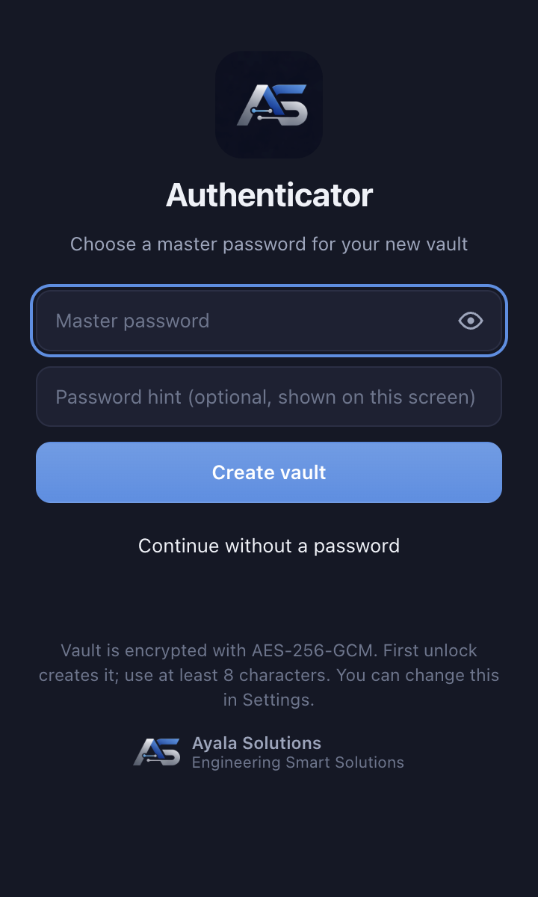

- Use at least 8 characters, and prefer a long phrase. The vault file sits in your browser profile, so the password is
  the only thing protecting it against offline guessing.
- The optional hint is shown in plain text on the lock screen to anyone who opens the popup. It cannot contain the
  password.
- The eye button shows what you typed.

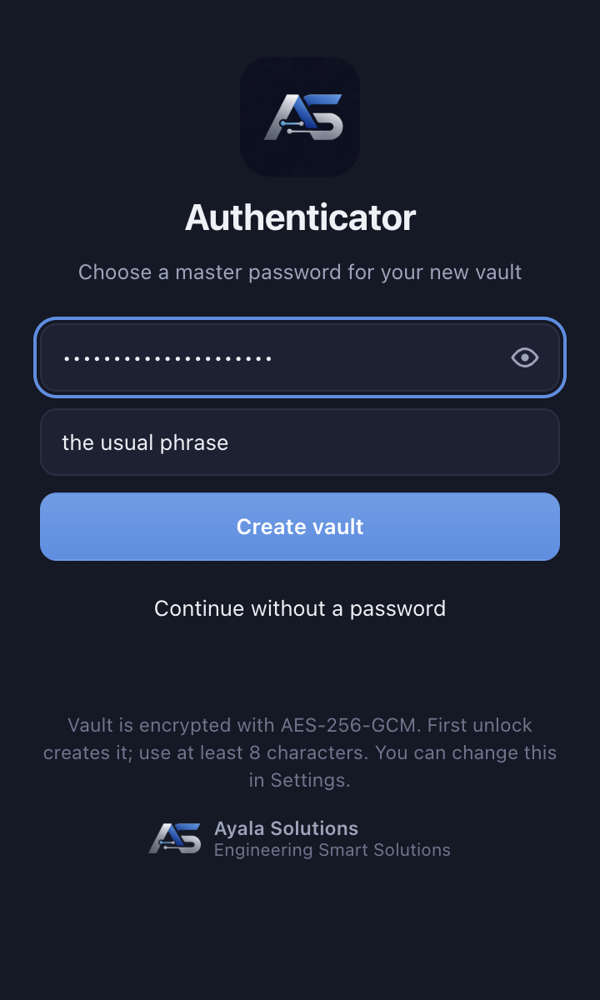
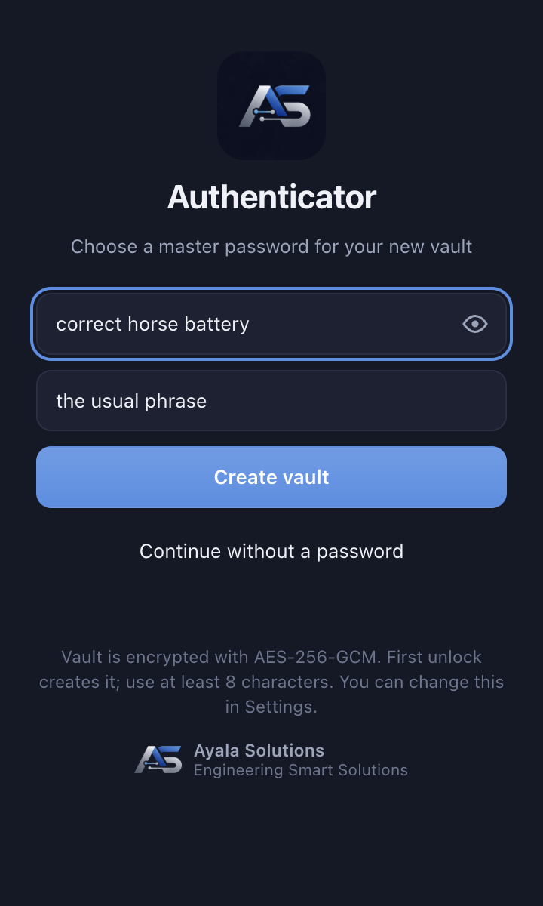

"Continue without a password" creates an unprotected vault: it opens without asking, there is nothing to lock, and
anyone with the browser profile or an exported file can read the codes. You can turn a password on later in Settings.

Right after the vault is created you get a recovery code, shown once.

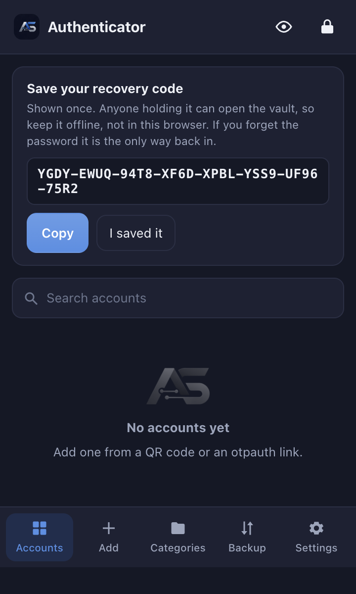

The recovery code opens the vault if you forget the password, so it has the same power as the password. Copy it
somewhere offline, not in this browser, then click "I saved it". There is no other way to recover a forgotten
password.

## The popup

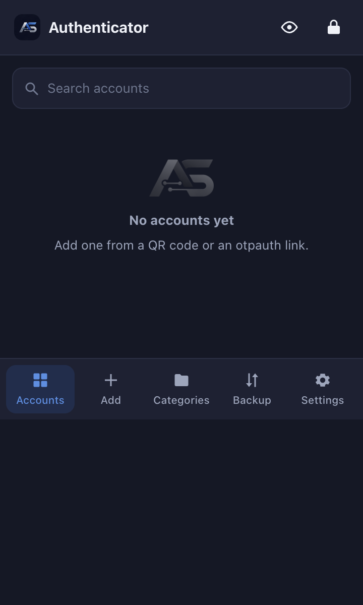

The header holds a countdown ring (seconds left on the current codes), the eye button (hide or show codes) and the
lock. The tab bar at the bottom switches between Accounts, Add, Categories, Backup and Settings.

## Accounts

Each row shows the service's icon, the issuer, the account label and the current code. Brand icons are matched
offline from a bundled set; when none matches, the site's own favicon is loaded from that site, and otherwise the
first letter is shown. You can also pick your own image for an account in its edit panel.

- The account for the site you are on is marked Suggested and listed first.
- Typing in the search box filters the list as you type.
- Pinned accounts stay at the top. Drag rows to reorder.

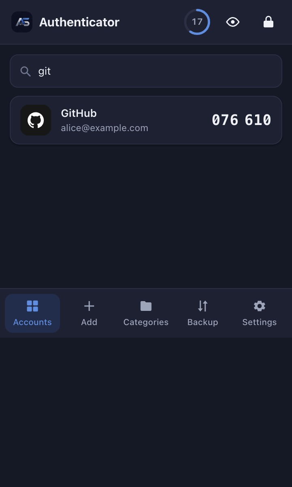

The eye button in the header masks every code as dots and remembers the choice. Copy and fill keep working; tapping a
masked code shows it for five seconds.

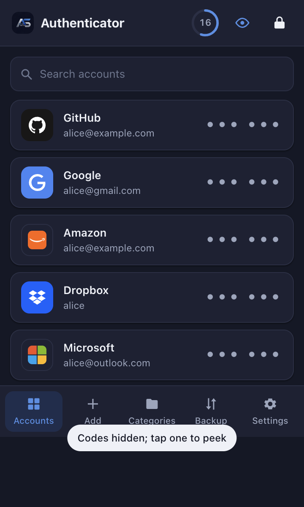

Open a row's edit panel to rename the issuer or label, set the account's website, choose an icon or assign a
category.

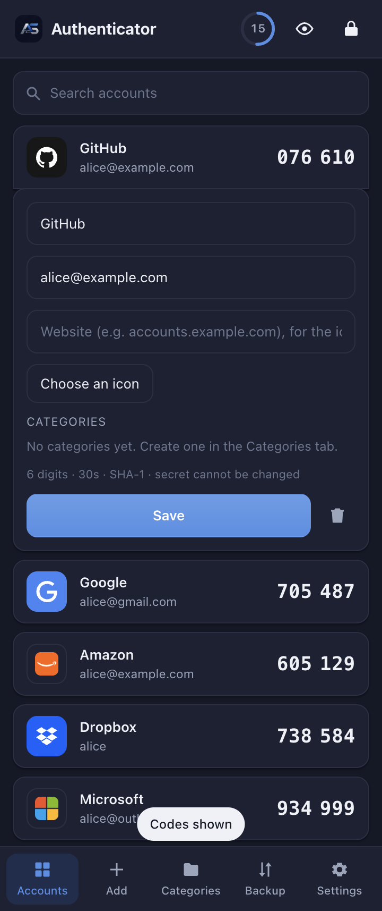

Delete asks for confirmation inline.

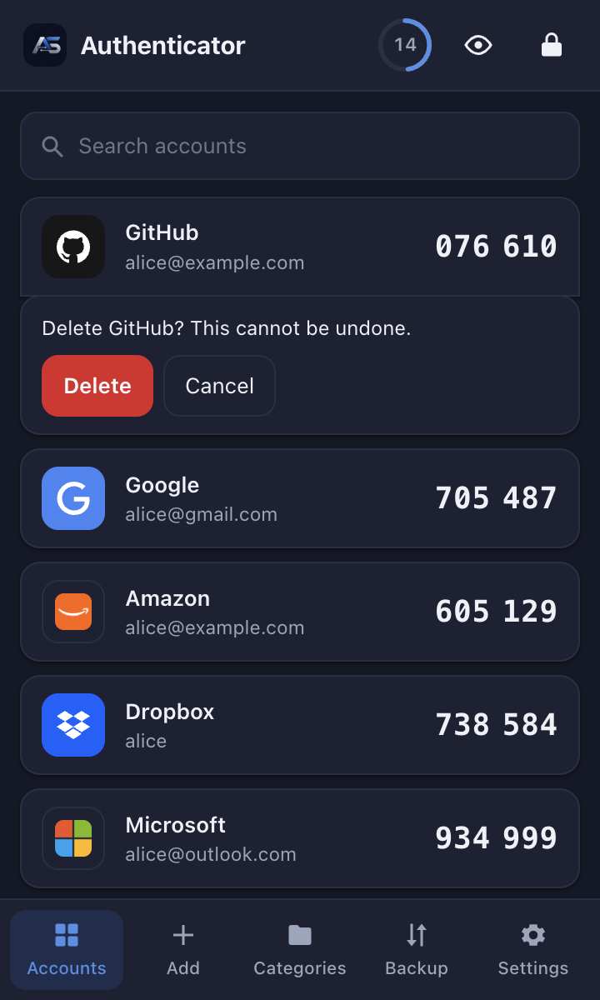

## Adding an account

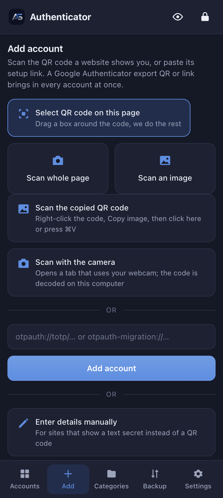

The Add tab offers every way to get a secret in:

| Method | How |
| --- | --- |
| Select a QR code on the page | Drag a box around the QR code shown by the site. Also available as a keyboard shortcut. |
| Scan the page | Captures the whole visible tab and finds the QR code. |
| Scan an image | Pick a QR image file from disk. |
| Scan the copied QR code | Right-click a QR code on a page, Copy image, then click this tile. Ctrl+V (⌘V on a Mac) in the popup does the same. |
| Use the camera | Opens a tab that scans with your webcam and stops the camera as soon as a code is read. |
| Paste a link | Paste an `otpauth://` link, or a Google Authenticator `otpauth-migration://` export link, which adds every account in it at once. |
| Enter details manually | Issuer, account, secret, type (TOTP, HOTP or Steam), digits, algorithm and period. |

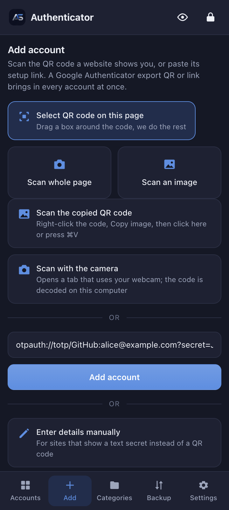
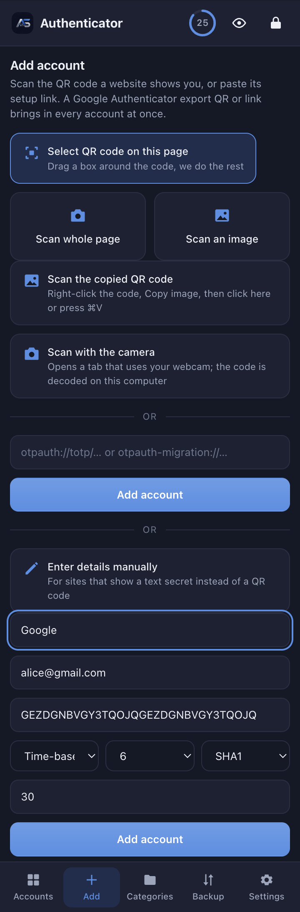

A secret that is already in the vault is refused with the name of the existing account, so scanning the same code
twice never creates a duplicate. Bulk imports skip such secrets and say how many.

HOTP (counter-based) accounts keep their counter in the vault; copying, filling or skipping a code advances it.

## Using a code

- Click the code to copy it. Thirty seconds later the clipboard is replaced with a blank (Chrome, Edge, Brave and
  Firefox; see Settings to turn this off).
- The bolt on a row fills the code into the login field on the current page, including split six-box forms. Only the
  one best field on the page gets the code; third-party frames never do.
- Keyboard shortcuts work while the vault is unlocked, without opening the popup:

| Action | Windows and Linux | Mac |
| --- | --- | --- |
| Fill the code for this site | Ctrl+Shift+U | ⌘⇧U |
| Select a QR code on the page | Ctrl+Shift+Y | ⌘⇧Y |

The fill shortcut only acts when exactly one account's name or stored site matches the page's hostname; it never
guesses. Change the keys in your browser's extension shortcut settings.

## Categories

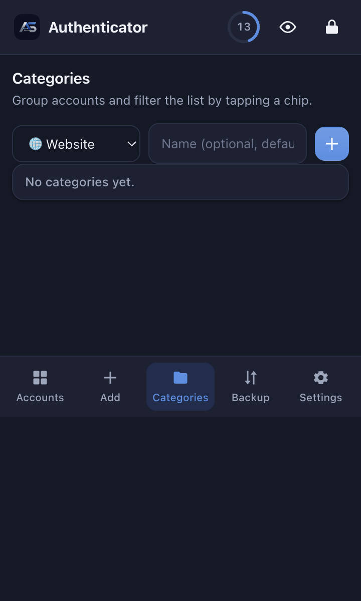

Pick an icon, type a name (or leave it blank to use the icon's label) and press +.

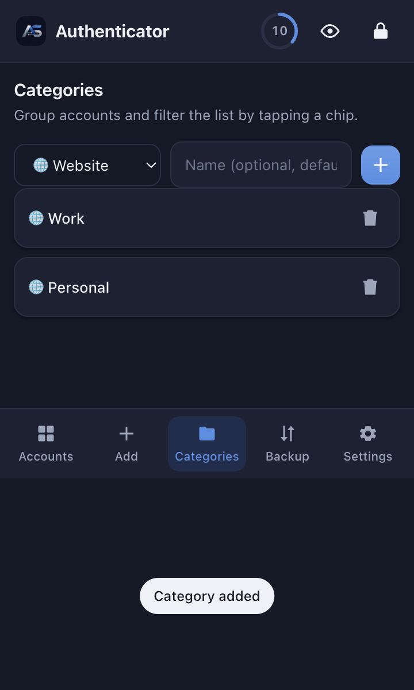

Assign a category from an account's edit panel. Chips above the accounts list then filter it.

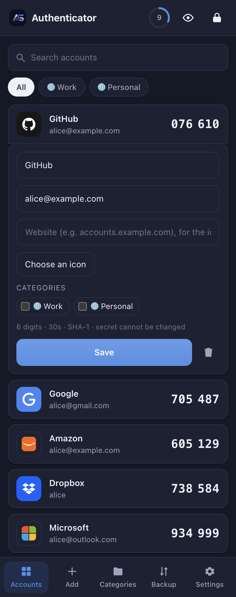

## Backup

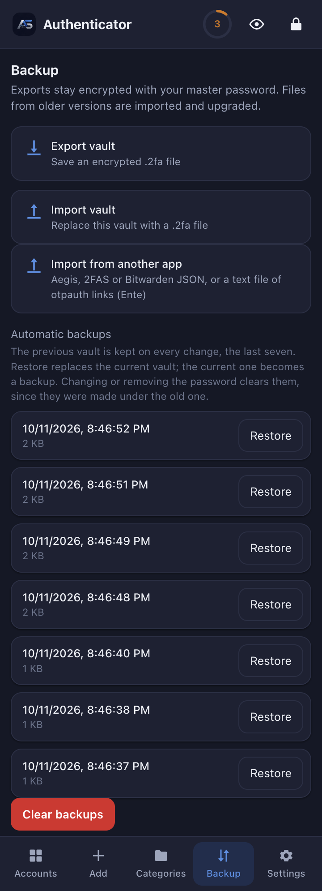

- **Export vault** saves an encrypted `.2fa` file protected by your master password. With password protection off,
  the file is readable by anyone, and the view says so.
- **Import vault** replaces the current vault with a `.2fa` file. It asks for that file's password first; the accounts
  are then re-encrypted under your current master password.
- **Import from another app** reads Aegis, 2FAS and Bitwarden JSON exports, or a text file of `otpauth://` links
  (for example from Ente).
- **Automatic backups** lists the previous vaults kept on every change, the last seven. Restore replaces the current
  vault. **Clear backups** empties the list. Changing or removing the password, or recovering with a code, clears
  them too, so nothing stays encrypted under a key you moved away from.

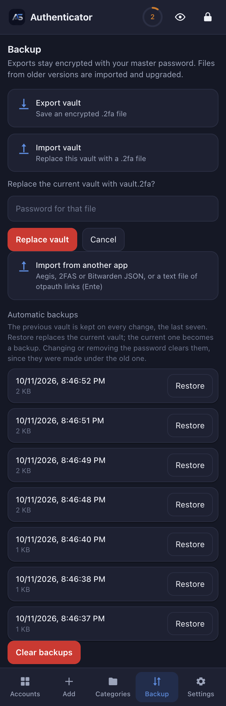

After ten changes without an export, the accounts view shows a reminder card. Export now, or Later.

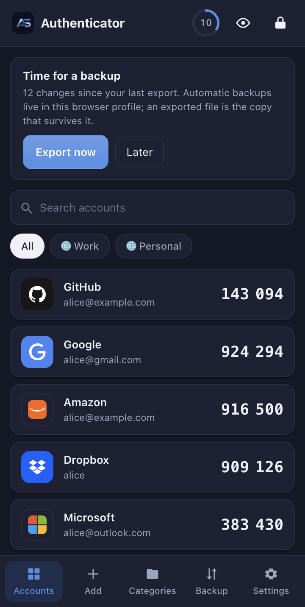

## Settings

Every choice applies immediately.

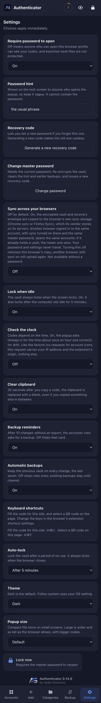

| Setting | What it does |
| --- | --- |
| Require password to open | Off re-encrypts the vault under an empty password: it opens without asking and nothing is protected. Turning it back on asks for a new password. |
| Password hint | Shown on the lock screen to anyone who opens the popup. |
| Recovery code | Generates a new code; the old one stops working. |
| Change master password | Proves the current one, re-keys the vault, clears the hint and earlier backups, and issues a new recovery code. |
| Sync across your browsers | Off by default. On, only the encrypted vault is copied to Chrome sync or Firefox Sync, so another browser signed in to the same account with the same master password opens the same accounts. Needs a password. |
| Lock when idle | The vault always locks when the screen locks. On, it also locks after five idle minutes. |
| Check the clock | Off by default. On, the popup asks timeapi.io for the time about once an hour and corrects drift. |
| Clear clipboard | Thirty seconds after a copy the clipboard is replaced with a blank. |
| Backup reminders | The "Time for a backup" card after ten changes without an export. |
| Automatic backups | Keep the previous vault on every change. Off stops new ones; existing backups stay until cleared. |
| Keyboard shortcuts | Shows the current keys. |
| Auto-lock | Lock after a period of no use: 1 minute to 1 hour, or only when the browser closes. |
| Theme | Dark (default), Light, or Follow system. |
| Popup size | Compact, Default or Large. |
| Lock now | Locks immediately. |

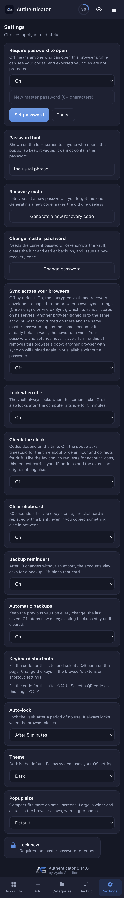
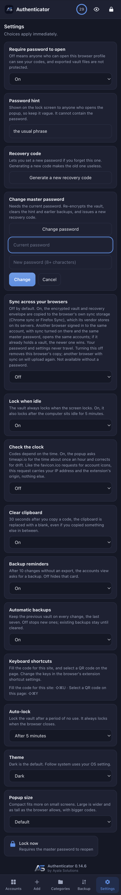
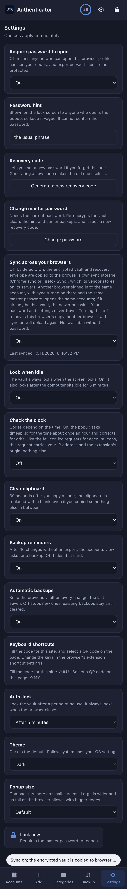
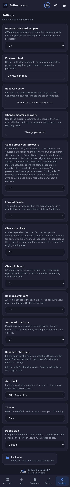

Themes:

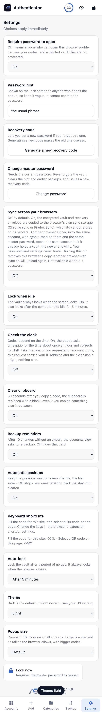
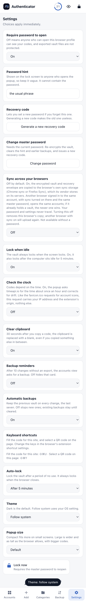
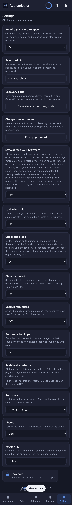
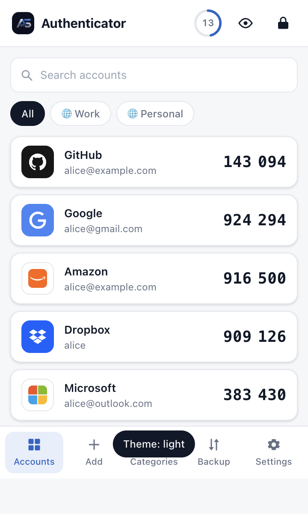
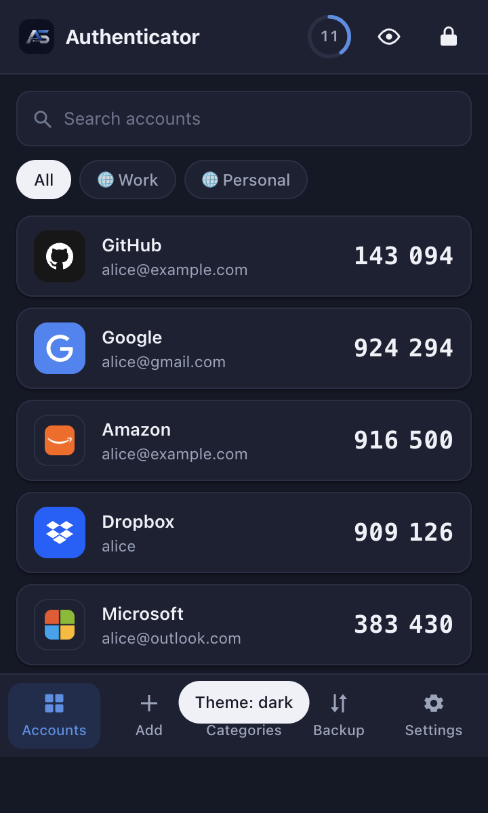

Popup sizes:

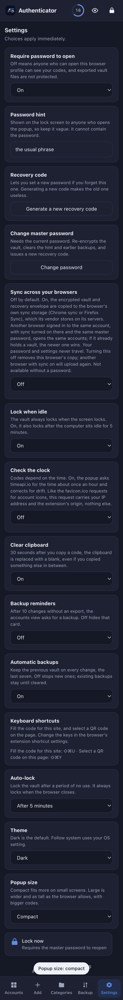
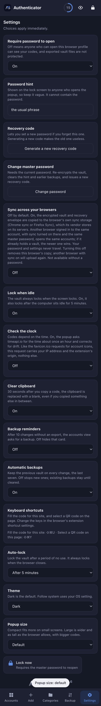
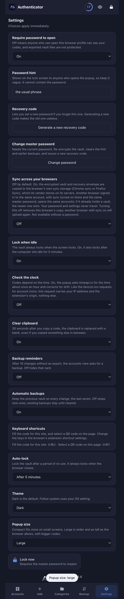

## The lock screen

Enter the master password to unlock. The hint, if you set one, is shown under the field. A wrong password is refused.

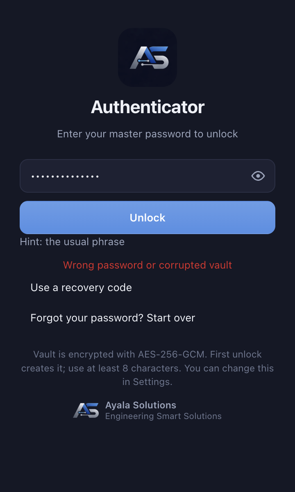

**Use a recovery code** opens the vault with the saved code, asks for a new password and issues a new code.

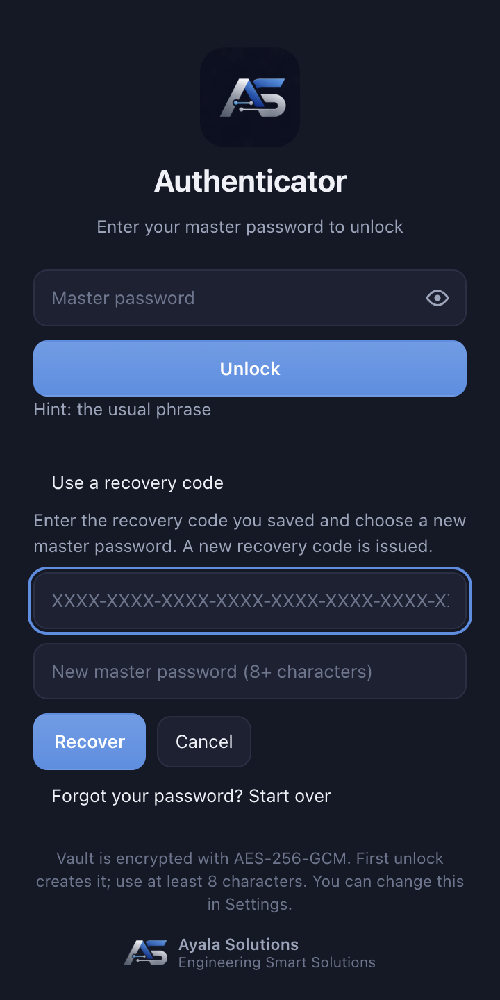

**Start over** deletes the vault after a confirmation, exactly as removing the extension would. There is no other
reset: without the password or the recovery code, the vault cannot be opened.

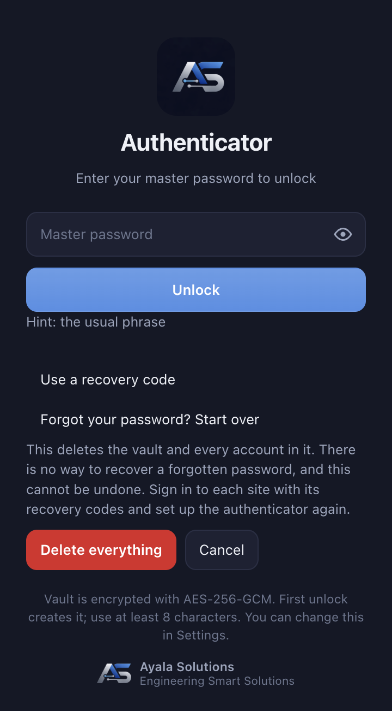

## Browser differences

| | Chrome, Edge, Brave | Firefox | Safari |
| --- | --- | --- | --- |
| Lock on screen lock or idle | Yes | Yes | No (Safari has no idle API) |
| Clipboard clearing | Yes | Yes, best effort | No |
| Scan the copied QR code | One click, or Ctrl+V | One click, or Ctrl+V | Through the AS Authenticator app, or ⌘V |
| File pickers (scan an image, imports) | In the popup | Open the extension in a tab first, since Firefox closes a popup when a picker opens | In the popup |
| Sync | Chrome sync | Firefox Sync | Not available |
| Account icons | Brand set, then the site's favicon, then the browser's favicon cache | Brand set, then the site's favicon | Brand set, then the site's favicon |

## Questions

- **Does anything leave my device?** No account, no server, no analytics. The only requests the extension makes on
  its own are the favicon loads for account icons (to the account's own site) and, if you turn it on, the hourly clock
  check. See [PRIVACY.md](../PRIVACY.md).
- **How is the vault encrypted?** AES-256-GCM under a key derived from the master password with Argon2id. The format
  is documented in [VAULT-FORMAT.md](VAULT-FORMAT.md).
- **I forgot my password.** Use the recovery code on the lock screen. Without it, the vault cannot be opened; Start
  over deletes it so you can begin again from your providers' recovery methods.
- **Something looks wrong or broken.** Open an issue in this repository. For a possible vulnerability, follow
  [SECURITY.md](../SECURITY.md) instead.
